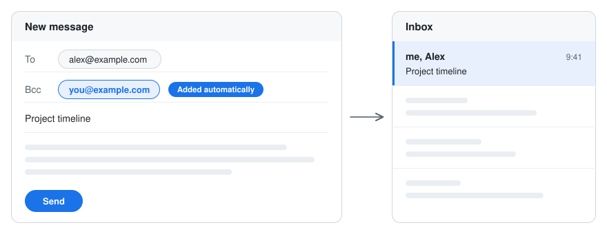

### `Auto BCC Myself for Gmail`

A Firefox add-on that adds you as Bcc on every Gmail message you write, so threads you send stay in your inbox.

  <a href="https://addons.mozilla.org/firefox/addon/auto-bcc-myself-for-gmail/">
    Install
  </a>
  •
  <a href="./docs/development.md">
    How it works
  </a>
  •
  <a href="./PRIVACY.md">
    Privacy
  </a>
  •
  <a href="https://github.com/semicolonconsulting/autobccmyself/issues">
    Report a problem
  </a>

 

<picture>
  <source media="(prefers-color-scheme: dark)" srcset="./docs/assets/preview-dark.svg">
  
</picture>

### Why

Gmail files the messages you send under Sent only, so a thread you're waiting on drops out of sight until someone replies. With yourself in Bcc, a copy lands in your inbox and the thread stays in front of you.

### What it does

- Opens the Bcc field in every compose window (new message, reply, reply all and forward) and adds your address.
- Shows the Bcc right away, so you can remove it from any message before you send.
- Skips messages where you're already in To, Cc or Bcc.
- Uses the Gmail account you're signed in to, or a fixed address you set in the toolbar popup. The popup also has an on/off switch.

Works in Firefox 140 and later, and in Firefox-based browsers that install from the same store, such as Zen.

### Privacy

Everything stays in your browser. The add-on collects no data and makes no network requests. See the [privacy policy](./PRIVACY.md).

### Contributing

Gmail changes its page from time to time. If the add-on stops adding the Bcc, please report it on the [Issues page](https://github.com/semicolonconsulting/autobccmyself/issues). To build it or change the code, see [docs/development.md](./docs/development.md).

### License

[MIT](./LICENSE). Not affiliated with Google. Gmail is a trademark of Google LLC.
